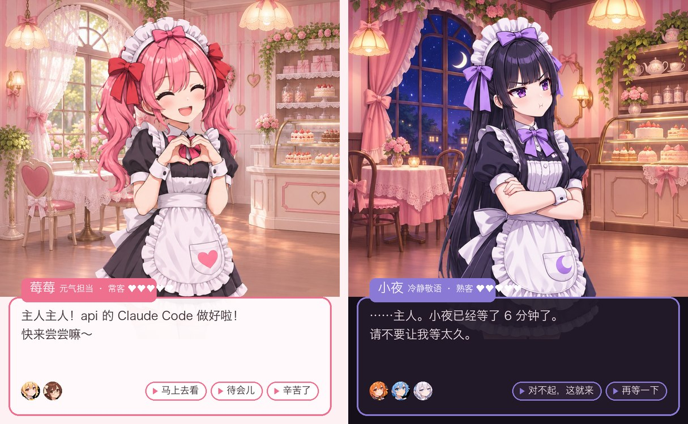

# Maid Café ADV · 女仆咖啡馆恋爱 ADV 布局 for Herdr



把 Herdr 做成一部 galgame。你是「主人」，每个 Agent 是一位原创女仆。Agent 做完了或卡住了，女仆就排队来找你说话。**舞台上同一时间只站一位女仆**，其他人在对话框下方排队，所以同一个 space 开再多 Agent 也不会挤。

## 和普通布局的区别

- **没有侧栏地图**。窗口是 ADV 的版式：上面是章节（space）和书签（tab），中间是终端和右侧舞台，底部是对话框。
- **状态变成台词**：做好了 → 「主人主人！api 的 Claude Code 做好啦！」；等你 → 「唔……需要主人拿主意！」；等超过 5 分钟 → 换成生气表情再催一次；新 Agent 出现 → 自我介绍；启动时 → 女仆长「铃」问候，并汇报店里的现状。
- **选项就是操作**：「马上去看」会跳到她的窗格，「待会儿 / 再等一下」会过几分钟再提醒，「辛苦了」表示收下。选完以后她会回你一句。
- **好感度**：回应得快，好感会涨（等你时 1 分钟内回应 +2）；让她等太久会扣分。好感分 6 个称号：初次见面 → 熟客 → 常客 → 好朋友 → 特别的人 → 命中注定。
- **9 位角色**：8 位女仆，每人有自己的性格和台词（元气、冷静敬语、活泼、慵懒、害羞、假小子、傲娇大小姐、猫系），加上旁白女仆长「铃」。每人有 4 张表情差分立绘：普通、开心、询问、生气。
- 舞台顶部的「今日当班」一栏列出所有 Agent 的头像，点头像跳到对应窗格；正在说话的那位，她的窗格头会亮起她的颜色。
- 对话框右下角是 LOG（回看最近 60 句）、AUTO（每 6 秒轮到下一位）、SKIP（清空队列）、CONFIG（设置）。
- 系统切到深色时进入夜间营业，背景换成夜景。

## v2 新增

- **直接回复她**：女仆来找你时，对话框里会出现「回复她」输入框。打字回车，文字就发给她的程序（`hc send`；她在等你时会带 `--force`），不用切过去。她会回你一句「收到！」，好感照算。
- **标题画面**：每天第一次打开时，像 galgame 一样出现主视觉封面（9 位角色合照），有「开始营业 / CG 鉴赏 / 营业日报 / 设置」。之后点对话框菜单里的 TITLE 可以再打开。
- **CG 鉴赏**：和某位女仆好感到「常客」，会解锁一张她的专属 CG（莓莓画番茄酱爱心、小夜在月光下倒红茶、葡萄傲娇地推来芭菲……），带「CG 解锁！」横幅和一句专属台词。未解锁的显示模糊剪影和进度。
- **营业日报**：女仆长每晚 18 点后提议一次，也可以从标题画面打开：完成几份、被呼叫几次、平均响应时间、最久的一次等待、今日 MVP、直接回复次数、今天收获的好感，最后附一句评语。
- 急事可以打断闲聊：问候、自我介绍、日报这类不急的台词，遇到「做好了 / 等您吩咐」会让位。
- 素材改成 WebP 和 JPEG，从 22MB 压到 7MB 左右。

## v3 新增

- **她读懂你的工作**：Agent 做完或卡住时，女仆会读一次它的终端屏幕，请本机的 `claude -p --model haiku` 按她的性格概括成一两句汇报，比如「主人，x.py 里的 a=1 已经改成 a=2 了……才不是特意为你检查的呢！」。概括要几秒，先显示普通台词，拿到后再重新打一遍字；失败就保留普通台词。
- **确认框变按钮**：卡在 `❯ 1. Yes / 2. No` 这类确认菜单或 `[y/n]` 提问时，对话框里的选项变成「选 1：Yes」这样的按钮，点一下就替你按那个键（`hc keys`），这时不显示文字回复框。对话框菜单的 SMART 可以整个关掉（关掉后不读屏、不调用 claude）。
- **立绘会动**：说话时嘴巴开合，平时每 3～6 秒眨一次眼。12 月 18～26 日自动换圣诞服装。
- **个人剧情**：和某位女仆好感到「好朋友」，解锁她的 3 幕剧情，第 2 幕结尾有一个选择，两个结局，好结局展示她的 CG。读过的剧情可以在 CG 鉴赏室重看。
- **纪念日和生日**：标题画面显示「营业第 N 天」，第 7、30、100 天女仆长会说纪念台词；每位女仆有自己的生日，当天由她来开店问候。
- **同屏插话**：有几位女仆同时在排队、又没有急事时，排在后面的那位偶尔在舞台左下角插一句（10 分钟最多一次）。
- **关心你的作息**：连续营业 90 分钟建议休息 5 分钟；🍅 番茄钟（25 分钟，顶栏显示剩余分钟）；晚上 7 点后提醒下班；每天第一次问候会提到昨天的日报；周五起可以看「本周回忆」（每天完成数、本周 MVP、本周解锁的 CG）。

读屏概括会运行本机的 `claude` 命令，把终端末尾约 60 行发给 Claude。不想这样，就点对话框菜单里的 SMART 关掉。

## 测试

`./tests/run.sh`：用 mock 掉的 herdr 跑对话引擎的完整流程（排队优先级、生气催促、待会儿、回复、好感、日报），以及 v3 的读屏选项、概括失败兜底、季节服装、作息计时（mock 时钟）、剧情两个结局、纪念日 / 生日 / 插话。

## 安装

```sh
./install.sh
herdr-app do layout.switch '{"name":"maid-adv"}'
```

只复制本布局自己的文件（`layouts/maid-adv.*`、`themes/maid-adv*.json`、`mods/maid-adv/`）。`cmd-b` 开关舞台，合并进 keys.json 前会先询问并备份。

## 换角色

立绘由 Codex 生成（绿幕、一张 4 格表情差分）。放进 `art/ai/<id>/<id>-sheet.png`，在 `art/build.py` 的 `CAST` 里加一行，在 `mods/maid-adv/lines.js` 里写她的台词，然后运行 `python3 -I art/build.py` 和 `./install.sh`。闭眼 / 张嘴差分放在 `art/ai/<id>-blink/`、`art/ai/<id>-talk/`（`art/gen_v3.sh` 生成），build 会自动对齐并只切眼睛和嘴的小块。

加季节服装：在 `art/build.py` 的 `OUTFITS` 登记动作表路径，在 `mods/maid-adv/state.js` 的 `OUTFITS` 加一行日期。

在 Herdr GUI 0.1.11（macOS）上构建和检查。代码 MIT。
